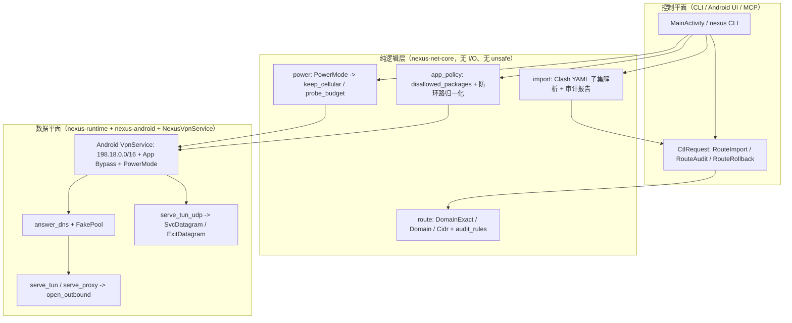

# Nexus Next 网络运行时设计文档（N0 / N1 / N2）

- **文档版本**：v1.0
- **日期**：2026-11-27
- **基线仓库**：`medivhc/nexus-next`
- **基线 Commit SHA**：`d85380dcf137a3a1550569e291dbb77454943231`（`Cargo.toml` 0.2.0 / Rust 1.85 / Apache-2.0）
- **上游依据**：`nexus-next-network-runtime-design-v0.1.md`（RFC v0.1）

---

## 1. 目标与边界

本设计文档将 RFC v0.1 落地为可直接编码、验收与测试的工程设计，聚焦首轮高优先级阶段 **N0（基线核实）→ N1（Android 日常替代最小集）→ N2（省电与稳定）**：

- **保留既有能力**：不重写设备身份、名册、授权、服务发布、终端、Workspace 与 QUIC Fabric；保持 `nexus-net-core` 纯逻辑、无系统 I/O、`#![forbid(unsafe_code)]` 约束（受 `tools/check.py` L0 门禁强校验）。
- **解决真实痛点**：
  1. 补齐通用公网 UDP 出口（解决 R91 仅支持已发布 UDP 服务的限制）。
  2. 支持 Clash / Mihomo 常用规则子集的可审计导入、冲突/遮蔽编译检查与 Last-Known-Good（LKG）一键回滚。
  3. 支持 Android 按应用绕过 VPN（防环路自排除）与 UI 内一键停止/回退。
  4. 修复 Android 默认强制维持蜂窝链路（`multipath = true`）导致的后台耗电问题，引入 `Balanced / PowerSave / Realtime` 电源策略。
- **明确非目标（本阶段不做）**：不引入第二套协议栈、不默认开启 HTTPS MITM、不在数据转发热路径调用 LLM、不提前扩展至 N3–N7。

---

## 2. N0 现状核实与差距矩阵

依据基线 `d85380d` 源码与测试逐项核实（非臆测）：

| 需求/能力 | 现有实现证据（文件路径） | 当前状态 | 与 N1/N2 目标的差距 | 本阶段改造策略 |
|---|---|---|---|---|
| **R41 路由规则** | `crates/nexus-net-core/src/lib.rs` (`route::Matcher`, `decide`)、`crates/nexus-runtime/src/lib.rs` (`route_add/rm/explain`) | 仅支持 `Domain`（后缀匹配）和 `Cidr`；顺序首条命中；无导入、无冲突检查、无回滚 | 缺精确域名匹配（`DOMAIN`）、缺 Clash/Mihomo 规则子集导入、缺规则遮蔽/重复静态审计、缺 LKG 快照回滚 | 扩展 `Matcher::DomainExact`，新增 `import` 模块与 `audit_rules`，runtime 增加原子导入与 LKG 回滚 |
| **R42 出口** | `crates/nexus-runtime/src/lib.rs` (`open_exit`, `serve_exit`, `open_upstream`) | 仅支持 TCP（`Request::ExitConnect`、SOCKS5 CONNECT）；出口侧已通过 `is_own_address` 拦截回环地址 | 出口不支持通用公网 UDP；上游 SOCKS5 不支持 UDP 时无明确语义保护 | 新增 `Request::ExitDatagram`，复用 `net.exit` 权限与 `is_own_address` 保护；不支持 UDP 的出口明确拒绝，不偷偷直连 |
| **R43 完整节点** | `crates/nexus-net-core/src/lib.rs` (`dns`, `fakeip::FakePool`)、`crates/nexus-runtime/src/lib.rs` (`answer_dns`, `serve_tun`) | 198.18.0.0/16 FakeIP 池，`.internal` 与非直连规则域名分配临时 IP | 规则命中 `DomainExact` 时同样应被 FakeIP 捕获；规则导入/回滚需与现有运行态一致 | `answer_dns` 复用 `route::decide`，自动继承新规则类型与热更新 |
| **R46 Android 单 VPN 共存** | `android/.../NexusVpnService.java`、`MainActivity.java`、`crates/nexus-android/src/lib.rs` | 单 `VpnService` 仅接管 `198.18.0.0/16` 与 DNS `198.18.0.2`，自身已 `addDisallowedApplication`；仅 redroid 实测，真机待验 | 无法按应用配置绕过 VPN；UI 仅支持加入码与设备列表，无停止/回退按钮和电源模式控制 | 增加持久化应用绕过列表（强制含自身防环路）、电源模式切换与 UI 一键停止/状态面板 |
| **R87 / R88 Android 多路径与计费识别** | `NexusVpnService.java` (`watchNetworks`, `keepCellular`)、`crates/nexus-android/src/lib.rs` (`nativeSetNetworks`) | 默认 `multipath = true`，启动即调用 `cm.requestNetwork(TRANSPORT_CELLULAR)` 强制拉起蜂窝 | 有 Wi-Fi 时持续维持蜂窝电台，导致高待机功耗 | 引入 `PowerMode`（默认 `balanced`，`keep_cellular_with_wifi = false`），仅 `realtime` 或显式 `--ez multipath true` 时请求蜂窝 |
| **R91 完整节点 UDP** | `crates/nexus-runtime/src/lib.rs` (`serve_tun_udp`, `serve_datagram`)、`crates/nexus-runtime/src/datagrams.rs` | `serve_tun_udp` 仅处理 `Decision::Service`，对 `Outbound::Exit` 直接 `return` 丢弃 | 无法经出口节点转发公网 UDP（DNS/游戏/QUIC/实时通信） | 扩展 `serve_tun_udp` 支持 `Outbound::Exit(device)` 走 `Request::ExitDatagram`；`Reject`/`Socks5` 明确丢弃不降级直连 |

---

## 3. 架构设计

### 3.1 四平面边界与模块落点

### 3.2 纯逻辑层设计（`crates/nexus-net-core`）

严格满足 `tools/check.py` 约束：仅依赖 `serde`，禁用 `std::net`/`std::fs`/`tokio`/`SystemTime`/`Instant`/`unsafe`。

#### 3.2.1 路由匹配与静态审计（`nexus_net_core::route`）
- 扩展 `Matcher`：
  - `DomainExact(String)`：仅精确匹配归一化后的域名（如 `api.example.com` 不匹配 `sub.api.example.com`），与 `Domain(String)`（域名及所有子域名）清晰区分。
  - 保留原有 `Domain(String)` 与 `Cidr { net, prefix }`，完全向后兼容已有序列化的路由表。
- 新增 `audit_rules(rules: &[Rule]) -> RuleAudit`：
  - 检测 **重复规则**（`Duplicate`：与前序规则 matcher 完全一致）。
  - 检测 **被遮蔽的不可达规则**（`Shadowed`：例如前序存在 `Domain("example.com")`，后续 `DomainExact("a.example.com")` 或 `Domain("sub.example.com")` 永远无法命中；或前序宽 CIDR 覆盖后续窄 CIDR）。
  - 检测 **无效上游地址**（`InvalidUpstream`：`Outbound::Socks5(addr)` 无法通过 `Target::parse` 解析，或 `Outbound::Exit("")` 为空）。

#### 3.2.2 Clash / Mihomo 规则子集导入（`nexus_net_core::import`）
- 输入：Clash/Mihomo YAML 文本（含 `rules:` 段落或纯 `- RULE-TYPE,ARG,ACTION` 列表）以及 `ImportOptions { default_exit: Option<String>, default_socks5: Option<String>, fallback_action: Outbound }`。
- 支持的规则类型（可审计子集）：
  - `DOMAIN,<host>,<policy>` → `Matcher::DomainExact`
  - `DOMAIN-SUFFIX,<host>,<policy>` → `Matcher::Domain`
  - `IP-CIDR,<cidr>,<policy>[,no-resolve]` / `IP-CIDR6,<cidr>,<policy>[,no-resolve]` → `Matcher::Cidr`
  - `MATCH,<policy>` → 记录为默认出口提示（不静默覆盖安全底线）
- 策略映射：
  - `DIRECT` → `Outbound::Direct`
  - `REJECT` / `REJECT-DROP` → `Outbound::Reject`
  - `PROXY` / 其他节点组名 → 若配置了 `default_exit` 则映射为 `Outbound::Exit(device)`，否则若配置了 `default_socks5` 则映射为 `Outbound::Socks5(addr)`，否则记为未映射并跳过（绝不静默降级为直连）。
- 安全红线：
  - 明确忽略并报告 `SCRIPT`、`MITM`、`RULE-SET`、`GEOIP`、`PROCESS-NAME` 等不支持项，输出 `ImportReport { imported: Vec<Rule>, skipped: Vec<SkippedRule>, notes: Vec<String> }`。
  - 不自动启用脚本、MITM、新权限或导出私钥。

#### 3.2.3 电源模式模型（`nexus_net_core::power`）
- `PowerMode`: `Balanced`（默认） | `PowerSave` | `Realtime`
- `PowerPolicy`:
  - `Balanced`: `keep_cellular_with_wifi = false`, `idle_probe_interval_secs = 60`, `allow_multipath_redundancy = false`
  - `PowerSave`: `keep_cellular_with_wifi = false`, `idle_probe_interval_secs = 180`, `allow_multipath_redundancy = false`
  - `Realtime`: `keep_cellular_with_wifi = true`, `idle_probe_interval_secs = 15`, `allow_multipath_redundancy = true`
- 解决 RFC 第 2/9/14 节的核心问题：移动端在 `Balanced` 与 `PowerSave` 下**不主动调用 `requestNetwork(TRANSPORT_CELLULAR)` 维持蜂窝电台**。

#### 3.2.4 Android 应用绕过策略（`nexus_net_core::app_policy`）
- `AppPolicy { bypass_packages: Vec<String> }`
- `effective_disallowed_packages(&self, self_package: &str) -> Vec<String>`：
  - 去重、去空白、校验合法包名字符（`[a-zA-Z0-9._]`）。
  - **强制包含 `self_package`（`link.bewith.nexus`）**，即使配置清空也永不移除自身，杜绝 VPN 递归环路。

---

### 3.3 协议与运行时设计（`crates/nexus-wire`, `crates/nexus-runtime`）

#### 3.3.1 通用公网 UDP 出口（`Request::ExitDatagram`）
- 协议扩展（`nexus-wire`）：
  - `Request::ExitDatagram { target: String }`
  - `TrafficClass`：归类为 `TrafficClass::Interactive`。
  - 授权检查：与 `Request::ExitConnect` 完全一致——要求 `net.exit@<device>/exit` 能力，且目标节点 `exit_enabled == true`，所有连接写入审计日志。
- 出口端处理（`nexus-runtime::serve_exit_datagram`）：
  1. 解析 `target`（`Host::Ip` 或经出口侧 `system.resolve` 解析 `Host::Name`）。
  2. **安全过滤**：剔除所有 `is_own_address(&ip)`（`127.0.0.0/8`、`::1`、`0.0.0.0`、`::`）；若过滤后为空，返回 `ErrorCode::Denied`（「出口不连本机地址」）。
  3. 调用 `system.udp_connect(SocketAddr::new(ip, target.port))` 建立 UDP 套接字。
  4. 回复 `Response::Ok`，通过既有 `datagrams::relay` 进行 2 字节长度前缀的双向数据报转发（带 60 秒空闲回收，复用 R91 帧格式）。
- 客户端处理（`nexus-runtime::serve_tun_udp`）：
  - `Decision::Service { device, service }` → 维持 R91 既有逻辑（`SvcDatagram`）。
  - `Decision::Rule { outbound: Outbound::Exit(device), .. }` 或 `Decision::Default(Outbound::Exit(device))` → 调用 `open_stream(device, Request::ExitDatagram { target })` + `datagrams::relay`。
  - `Decision::Rule { outbound: Outbound::Reject | Outbound::Socks5(_), .. }` → **直接关闭/丢弃，绝不偷偷直连**（严格满足 RFC 4.1「代理不支持时明确报错/阻断，不偷偷直连」）。

#### 3.3.2 规则原子导入、审计与 LKG 回滚
- 存储键：
  - `KEY_ROUTES = "routes"`（当前生效规则）
  - `KEY_ROUTES_LKG = "routes_lkg"`（上一份已验证规则快照）
- 控制通道（`CtlRequest` / `CtlResponse`）：
  - `RouteImport { rules: Vec<Rule>, replace: bool }` → 先将当前 `routes` 持久化为 `routes_lkg`，再写入新规则；返回导入后总数与静态审计结果 `RuleAudit`。
  - `RouteRollback` → 若存在 `routes_lkg`，将其恢复为 `routes` 并持久化；否则返回明确错误。
  - `RouteAudit` → 对当前 `routes` 执行 `route::audit_rules` 并返回诊断列表。

---

### 3.4 CLI 与 Android 端设计（`crates/nexus-cli`, `crates/nexus-android`, `android/`）

- **CLI (`nexus-cli`)**：
  - `nexus route import <file> [--via <exit>] [--socks5 <addr>] [--replace] [--dry-run]`：解析 Clash/Mihomo 规则文件，打印导入/跳过审计报告；非 `--dry-run` 时通过 `CtlRequest::RouteImport` 下发并保存 LKG 快照。
  - `nexus route audit`：展示重复、被遮蔽、无效上游规则。
  - `nexus route rollback`：回滚到上一份 LKG 规则快照。
- **Android Core (`crates/nexus-android`)**：
  - 新增 JNI 桥接 `nativePowerPolicy(mode)`、`nativeEffectiveBypass(selfPkg, rawList)`（复用纯逻辑，Java 侧不重复写策略规则）。
- **Android 原生外壳 (`NexusVpnService.java`, `MainActivity.java`)**：
  - `NexusVpnService`：
    - 默认 `power_mode = "balanced"`（不请求蜂窝网络）；仅当 `power_mode = "realtime"` 或显式 `--ez multipath true` 时请求 `TRANSPORT_CELLULAR`。
    - 启动时读取 `getFilesDir()/app_bypass.txt` 并经 `NexusCore.nativeEffectiveBypass` 生成最终 `disallowed_packages`（强制包含 `link.bewith.nexus`）逐一调用 `addDisallowedApplication`。
    - 支持 `ACTION_RECONFIGURE`（切换电源模式或更新绕过应用后安全重启 VPN 并释放旧 callback）。
  - `MainActivity`：
    - 保留全部已有视图和 `contentDescription`（确保 `android_join_e2e.py` / `android_e2e.py` 完全兼容）。
    - 在「已加入网络」状态展示当前模式（平衡省电 / 实时多路径）、模式切换按钮、一键停止 VPN 按钮（保障 60 秒内快速回退既有方案）。

---

## 4. 安全与回退设计

1. **防 VPN 环路**：无论用户如何编辑应用绕过列表，`link.bewith.nexus` 始终位于 `disallowed_packages` 中。
2. **防出口 SSRF / 本机访问**：`serve_exit_datagram` 与 `serve_exit` 共享 `is_own_address` 校验，禁止任何远程节点借出口访问出口机 `127.0.0.0/8` / `::1` / `0.0.0.0`。
3. **防非授权直连泄露**：`serve_tun_udp` 对 `Reject` 与暂不支持 UDP 的 `Socks5` 上游直接丢弃，不降级直连；Clash 导入对未映射节点组跳过而非改写为 `DIRECT`。
4. **快速回退**：
   - 规则层面：`nexus route rollback` 原子恢复 LKG 快照。
   - 手机网络层面：应用内点击「停止 VPN」或 `am start ... --es action stop` 立即释放 TUN 与全部 `NetworkCallback`，恢复手机原有网络或原 Clash/EasyTier VPN（无需卸载原软件）。
